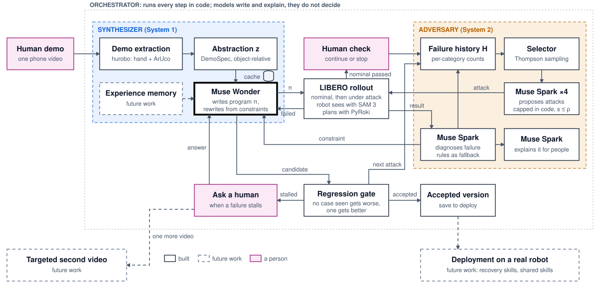
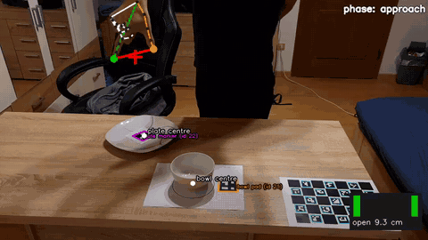
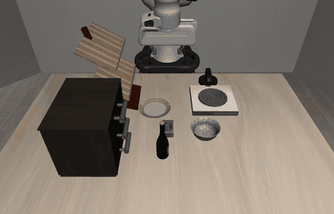
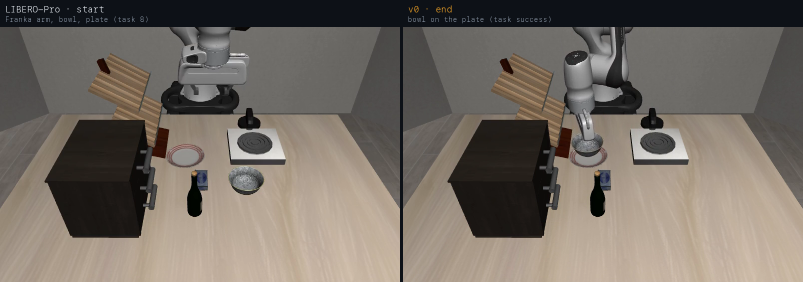
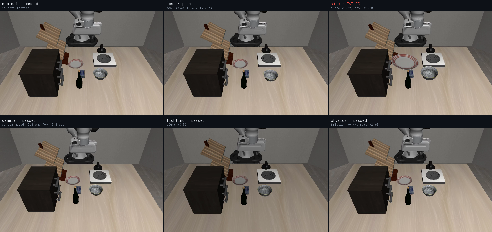
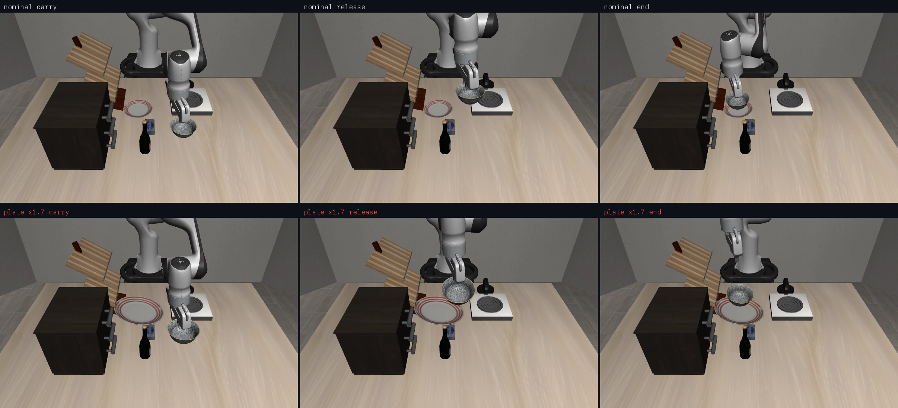

<p align="center"></p>

# ANTS: Agentic Task Synthesis

**Show a robot a task once. An adversary breaks it in simulation. Every failure becomes a readable fix, kept only if no case seen so far got worse.** No model weights are trained.

Our entry for the [Meta Global AI Developer Hackathon 2026](https://dev.meta.ai/events/global-hackathon).

## Problem

Robots learn one task at a time from lots of data, and nobody can say when they will fail. Small changes (a camera angle, a bigger plate) can break a skill that worked in the lab. A factory with a new part every week cannot use a skill it cannot trust.

## Solution



*Solid boxes are built and running. Dashed boxes are future work.*

| Part | What it does |
|---|---|
| **Synthesizer** (System 1) | Tracks one demonstration video, summarises it relative to object size, and has Muse Wonder write the robot program (v0), checked in simulation |
| **Adversary** (System 2) | Picks the weakest category (Thompson sampling), four Muse Spark agents propose attacks on the program's assumptions, severity is capped in code, LIBERO runs it, and the failure is diagnosed into a rule |
| **Gate** (orchestrator) | Replays every case seen so far; a rewrite is accepted only if it is no worse on all of them and better on one |
| **ANTS Studio** | One window to watch it: the Synthesizer chat and live cameras, and the Adversary's attacks, replays and versions |

## Show once: from one human video to the robot

| One human demonstration, with what extraction read (clip `233859`) | The program Muse Wonder wrote from it (v0, LIBERO-Pro) |
|---|---|
|  |  |

- **Tracking:** markers on the bowl, the plate and a ChArUco board give the hand and object paths in metres.
- **Summary (DemoSpec):** grasp the rim, approach from above, carry height, release over the plate, all as fractions of the object sizes, so they carry over to the simulated objects.
- **Program:** Muse Wonder writes a plain Python script over the robot API (`localize_object`, `move_to_pose`, `close_gripper`, …), checked on a nominal seed; one text repair made v0 pass.

## The task in LIBERO-Pro



LIBERO-Pro `libero_goal_swap`, task 8, "put the bowl on the plate": a Franka arm, the bowl, the plate, and other objects that are not part of the task. The robot sees through SAM 3 (RGB-D masks to point clouds) and plans with PyRoki, inside NVIDIA's ASPIRE `cap_harness`.

## How System 2 attacks



Each attack changes the scene before the program runs, within a severity cap of ρ = 0.8 enforced in code:

| Category | What changes | At the 0.8 cap |
|---|---|---|
| **pose** | where the bowl starts | moved up to about 6 cm |
| **size** | bowl and plate scale | bowl ×1.2, plate ×1.7 |
| **physics** | friction and bowl mass (invisible in a still) | friction ×0.44, mass ×2.6 |
| **actuation** | noise and delay on every arm command (invisible in a still) | 1.6 cm noise, 2 steps late |
| **camera** | the robot's camera pose and field of view | moved 4 cm, +3.2° |
| **lighting** | scene brightness | ×0.44 |

**One attack, step by step:** Thompson sampling picks the category most likely to fail → four Muse Spark agents read the program and each propose values that break one assumption (e.g. "the plate stays its demo size") → the values are clamped to the cap → LIBERO runs the program → on a failure, Muse Spark compares the program's printed measurements with the nominal run and writes one rule for Muse Wonder.

## What broke it



With a ×1.7 plate, SAM 3 measured the plate 11 cm tall instead of 2 cm (the mask likely merges with the cabinet behind it), so v0 let go about 9 cm too high and the bowl landed on the rim. Muse Spark traced it to `plate_top_z = max(...)`, Muse Wonder rewrote the support height from the plate's interior points, and the gate accepted v1.

## What we tested

Bowl-on-plate with a Franka arm in LIBERO, on an RTX 5090: **759 real simulator rollouts**, attack severity 0.3 to 0.8, held-out cases on scene seeds the system never trained or tuned on.

## Results

| Question | Result |
|---|---|
| Does one demonstration give a working program? | **Yes.** v0 passes **94% (47/50)** of held-out perturbed episodes |
| Does the adversary find real weak spots? | **Yes.** All failures come from one blind spot: SAM 3 mis-reads a larger plate. **0 failures in 599** rollouts with correct perception, **11 in 26** with a mis-read plate |
| Does the gate block bad fixes? | **Yes.** 3 of 3 rewrites that did not fix the failure were rejected |
| Can the loop repair itself? | **Yes, once.** Muse Spark diagnosed the cause from the measurements, Muse Wonder wrote a fix, and the gate accepted v1 |
| Does the fix generalise? | **Not yet.** Held-out size cases: v0 **98% (49/50)**, v1 **94% (47/50)**. The gate saw only 4 cases, so it missed regressions on unseen scenes |
| Does adaptive testing beat uniform testing? | **Not answered.** 2/200 vs 1/200 failures: v0 fails too rarely to compare |

Details, run folders and commands: [docs/results.md](docs/results.md).

## Meta models

| Model | Role |
|---|---|
| **Muse Wonder** | writes the program from the demonstration, and rewrites it after each failure |
| **Muse Spark** | four agents read the program and each propose an attack on one assumption |
| **Muse Spark** | diagnoses each failure into a cause and a rule |
| **Muse Spark** | explains each failure in plain language in the studio |
| **SAM 3** | the robot's perception: segments the bowl and the plate in every rollout |

The code maps effort levels to Muse Spark's Contemplating, Thinking and Instant modes; how the API selects those modes is unconfirmed, and "four agents" means four separate calls.

## Cost

| Item | Cost |
|---|---|
| Muse Spark (attacks, diagnoses, explanations) | $10.87 (805k tokens) |
| Muse Wonder (4 rewrites) | $1.40 (104k tokens) |
| One loop cycle | $0.17 to $0.55 |
| GPU | one RTX 5090 at $0.85/h |

Token prices at the observed $13.5 per million tokens.

## Vision

A test-and-repair layer for robot skills: from one demonstration, an integrator gets a program, an adversarial test report and an audit trail. Next: larger acceptance sets in the gate, perception checks the loop can learn, skills shared across tasks, and the same adversary testing any black-box robot policy.

## Quick start

Requires [uv](https://docs.astral.sh/uv/getting-started/installation/). Everything runs through `uv run`.

### Try it offline

No GPU or key: a toy world exercises the whole loop.

```bash
uv sync
uv run python -m ants.orchestrator.run --cycles 30 --out data/runs/mock_loop   # attack, rewrite, gate, escalate
uv run python -m ants.studio.console --adversary-run data/runs/mock_loop      # open http://localhost:8765
```

### Setup for real runs

Ubuntu 22.04, CUDA 12.8; we used one RTX 5090. You need approved access to [`facebook/sam3`](https://huggingface.co/facebook/sam3) and a Meta API key.

```bash
git submodule update --init ASPIRE && uv sync                                   # code and the ANTS env
(cd ASPIRE && scripts/bootstrap_libero.sh \
  && scripts/bootstrap_providers.sh --providers sam3,pyroki --profile rtx5090)  # simulator and models
export HF_TOKEN=hf_...; echo 'META_API_KEY=...' > .env                           # keys
(cd ASPIRE && TORCH_FORCE_NO_WEIGHTS_ONLY_LOAD=1 scripts/supervise_services.sh \
  --profile rtx5090 --providers sam3,pyroki)                                    # SAM 3 + PyRoki; keep running
uv run python -m ants.orchestrator.preflight --aspire $PWD/ASPIRE --muse-spark --smoke   # must print READY
```

Run one simulator job at a time, and pass the ASPIRE path as an absolute path. A rollout takes about 13 s on the 5090. Muse models spend tokens at about $13.5 per million, so every command below sets a budget.

### Start manually

**Synthesizer: one demonstration to a program.** `examples/bowl_on_plate/demospec.json` is a ready DemoSpec from our recording.

```bash
uv run python -m ants.studio.stock_scene     # measure the scene once (no model, no tokens)

uv run python -m ants.orchestrator.demo_vs_nodemo --aspire $PWD/ASPIRE \
  --demospec examples/bowl_on_plate/demospec.json --out data/runs/synth \
  --arms demo --temperatures 0.2 --scenes stock --debug-scene stock --eval-seeds "" \
  --repairs 5 --explain --token-budget 250000 \
  --scene-text-file data/scene_text/stock_seed51_S4.txt --evidence e3
```

| Argument | Default | Meaning |
|---|---|---|
| `--arms` | `nodemo,demo` | `demo` uses the DemoSpec; `nodemo` uses the task text only |
| `--temperatures` | `0.2,0.7,0.5,1.0` | one program per temperature |
| `--repairs` | `4` | retries on the debug seed |
| `--token-budget` | `600000` | hard cap on new tokens |
| `--task` | `put the bowl on the plate` | with `--suite libero_goal_swap --task-id 8` |

The program that passed is the attempt with `task_success: true` in `data/runs/synth/demo/sample0/record.json`.

**Adversary: attack a program.** `--policy` defaults to our example v0.

```bash
A="--backend cap_harness --aspire $PWD/ASPIRE"

# attacks only, no rewrites: why each attack, the replay, the diagnosis
uv run python -m ants.studio.run --attacks 8 $A --model muse-spark --token-budget 300000 --out data/runs/attacks

# closed loop: attack, diagnose, rewrite, gate; then 50 held-out cases
uv run python -m ants.orchestrator.run $A --model muse-spark --synthesizer muse-api \
  --synth-token-budget 400000 --categories size --cycles 10 --eval-held-out 50 --out data/runs/loop

# adaptive vs uniform test selection
uv run python -m ants.adversary.experiments.adaptive_vs_uniform $A --attacks 40 --seeds 0 1 2 3 4 --out data/runs/h1a
```

To attack your own program, add `--policy data/runs/synth/demo/sample0/program_attempt<N>.py`. Use `--model mock` for free rule-based attacks and diagnosis. A Muse Spark attack takes 1 to 2 minutes for its four agents.

**Watch a finished run:** `uv run python -m ants.studio.console --adversary-run data/runs/loop`. The README images come from these runs: `tools/make_readme_media.py`.

### Start with the UI

After the setup above, ANTS Studio runs the same pipeline from one window. To use your own video, also run `git submodule update --init hurobo && (cd hurobo && uv sync)`. Rewrites use the `muse` CLI, so install it too.

```bash
uv run python -m ants.studio.console     # open http://localhost:8765 (--port to change, --video-dir for your clips)
```

1. **Pick a video (optional).** Click `/policy-dev`, then `+`. Videos need the marker setup: ArUco markers on the bowl, plate and table in view. With no video, the Synthesizer works from the task text alone.
2. **Type the task** after `/policy-dev`, for example `put the bowl on the plate`, and press Enter.
3. **Choose the settings and click Run:**

   | Setting | Default | What you can do |
   |---|---|---|
   | Synthesizer | on | off: give your own script to attack |
   | Max retries | 5 | |
   | Adversary | on | off: save the program to `data/deploy/` and stop |
   | Stop after candidate v0 | on | off: go straight to the attacks |
   | Selector | Thompson | or random |
   | Attacks, seeds | 2, 1 | |
   | Muse Spark | off | on: real proposals, diagnosis and explanations, with its own token cap |
   | Token cap | 300,000 | checked before each model call, with worst-case cost shown |

4. **Watch it run.** The chat shows each stage and a card per attempt: why it changed, the program diff, the feedback and a looping rollout. The right column shows your video with the tracking overlay, then the live cameras during rollouts. The process flow lights up each step, and tokens spent are next to the status.
5. **Decide at the human check.** When v0 passes, the run waits with its rollout looping. Nothing is spent. Click **Continue to the Adversary** or type `/continue`.
6. **Inspect the attacks.** Use the **Adversary | Synthesizer** switch at the top. Adversary shows Harden, Replay with video, and Versions with diffs and gate verdicts.
7. **Step in at any time.** **Stop** ends the whole run. If the loop stalls, it asks you, and your answer becomes a rule it must keep. `/deploy` saves the latest program to `data/deploy/`. **New session** starts clean.

Every run is saved in `data/console_sessions/`, with all its settings in `execution.json`.

## Docs

[Results](docs/results.md) · [Concept](docs/concept.md) · [Architecture](docs/architecture.md) · [Context and decisions](docs/context.md) · [For coding agents](AGENTS.md)

## License

[Apache-2.0](LICENSE). Third-party models (SAM 3, Muse) and datasets keep their own licenses.
