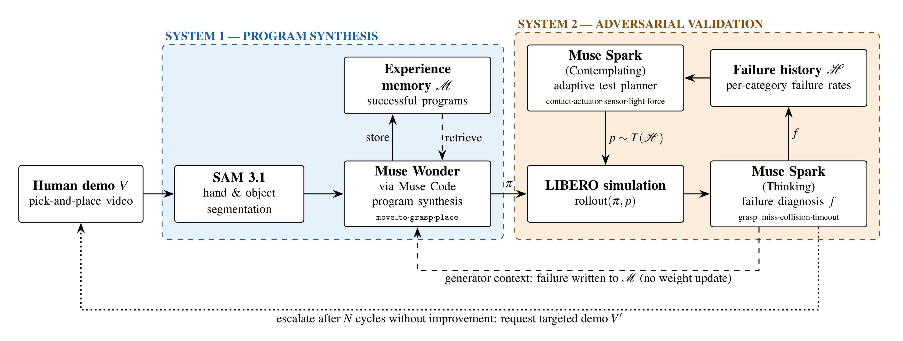

# Concept

ANTS (Agentic Task Synthesis) learns a robot skill from one demonstration with a frozen generative model, then hardens it with an adversarial test loop. Improvement comes from context, not weight updates. Nothing is trained.

## Problem

One robot, one task, one policy. Every new task, scenario or robot embodiment needs new data and fine-tuning, so data is the bottleneck.

## Components

- **System 1, synthesizer:** a frozen generator turns one video demonstration (segmentation, hand/object keypoints, gripper aperture) into a policy.
- **System 2, adversary:** a test planner proposes perturbations within a bounded severity, a simulator runs them, and a diagnoser explains each failure.
- **Closed loop:** every failure becomes a constraint added to the generator's context, and the generator proposes a new candidate policy.
- **Adaptive testing:** the test budget goes to the failure categories most likely to break the policy, not to uniform sampling.
- **Gate:** a candidate is accepted only if it does at least as well as the current best on every case seen so far, so robustness never regresses.
- **Memory:** past policies are stored and retrieved by similarity, weighted by how often they helped; unused ones fade. This is how skills are shared.
- **Stop or escalate:** stop when every category is confidently robust. If the generator stalls, ask a human for one targeted demonstration.

## Evaluation

Tune only on an acceptance set. Report on a held-out test set that is never used for tuning. All reported numbers come from logged runs.

## Vision

Skills written from a single demonstration, hardened by an adversary, shared through memory. Every failure becomes a constraint or one more human demonstration.

## Hackathon architecture

Meta Global AI Developer Hackathon 2026 concept. Figure taken from the team's one-page paper.

| Block | System | Tool |
| --- | --- | --- |
| Hand and object segmentation | 1 | SAM 3.1 |
| Policy synthesis, with experience memory M | 1 | Muse Wonder via Muse Code |
| Adaptive test planner using failure history H | 2 | Muse Spark (Contemplating) |
| Rollout of policy pi under perturbation p | 2 | LIBERO simulation |
| Failure diagnosis (grasp miss, collision, timeout) | 2 | Muse Spark (Thinking) |

Deliverables: live demo (v0 fails under attack, then is fixed in code; a second run escalates), success on 50 held-out perturbed cases (v0 vs. final), adaptive vs. uniform failures found per rollout, and cost in tokens and sim time per cycle.

## Software stack

Models and simulator follow the hackathon concept above (SAM 3.1, Muse Wonder/Muse Code, Muse Spark, LIBERO, Franka arm). Still undecided: memory / retrieval store and the exact perturbation categories.

Python is managed with uv and works on Windows, Ubuntu and macOS.
