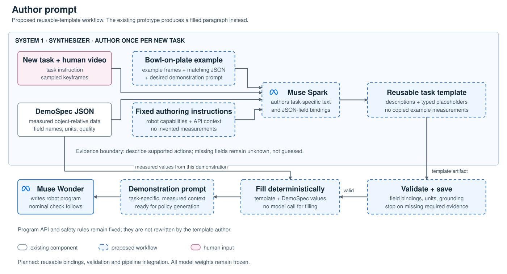
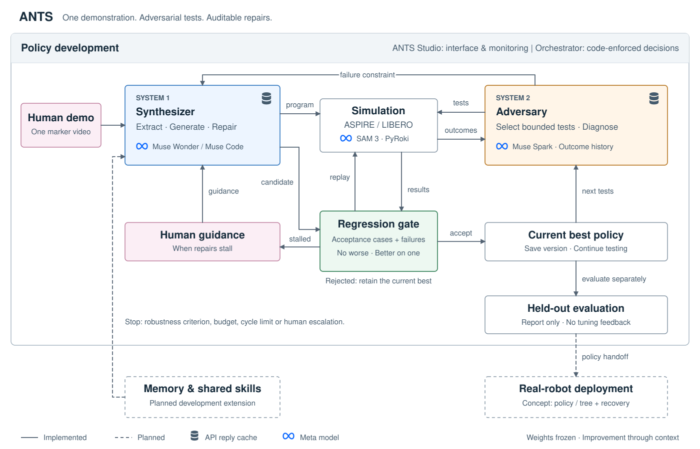
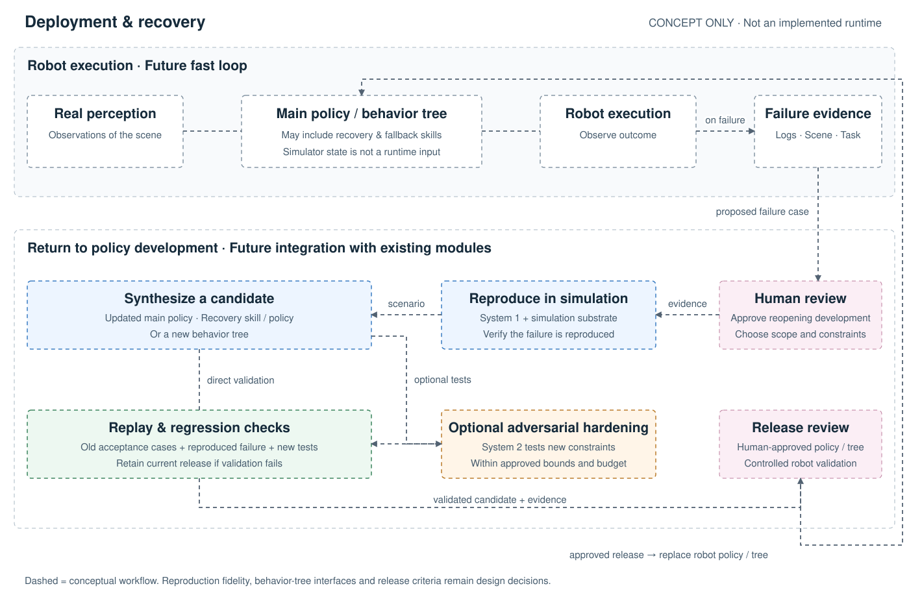

# Concept

ANTS (Agentic Task Synthesis) learns a robot skill from one demonstration with a frozen generative model, then hardens it with an adversarial test loop. Improvement comes from context, not weight updates. Nothing is trained.

## Problem

One robot, one task, one policy. Every new task, scenario or robot embodiment needs new data and fine-tuning, so data is the bottleneck.

## Components

- **System 1, Synthesizer:** a frozen generator turns one video demonstration (hand and object tracks from fiducial markers, gripper aperture) into a policy.
- **System 2, Adversary:** a test planner proposes perturbations within a bounded severity, a simulator runs them, and a diagnoser explains each failure.
- **Closed loop:** every failure becomes a constraint added to the generator's context, and the generator proposes a new candidate policy.
- **Adaptive testing:** the test budget goes to the failure categories most likely to break the policy, not to uniform sampling.
- **Gate:** a candidate is accepted only if it is no worse than the current best on nominal acceptance cases and discovered failures, and better on at least one. This is a guarantee on retained cases, not unseen scenarios or every successful attack previously sampled.
- **Memory (not built):** past policies would be stored and retrieved by similarity, weighted by how often they helped, with unused ones fading. This is how skills would be shared.
- **Stop or escalate:** stop when every category is confidently robust. If the generator stalls, ask a person. Today that is a typed answer that becomes a constraint; one targeted demonstration is future work.

## Author prompt

**Part of System 1, Synthesizer.** Instead of hand-writing a demonstration prompt for every new
task, Muse Spark would author a reusable task template from the task instruction, sampled human-video
frames and the extracted DemoSpec JSON. A worked bowl-on-plate example supplies matching frames,
JSON and the desired prompt to demonstrate the format, not to supply numbers for the new task.

1. **Author once per new task.** Muse Spark receives demonstration evidence, the worked example,
	and fixed authoring instructions with robot capabilities and API context. It writes task-specific
	descriptions plus placeholders bound to measured JSON fields.
2. **Validate and save.** Check that bindings resolve, units agree and numerical claims have
	measured sources or explicit derivations. Missing required evidence stops preparation rather
	than being guessed. Save the validated template for reuse.
3. **Fill deterministically.** Insert each demonstration's measured values without another model
	call. The example's object names and measurements must not leak into unrelated tasks.
4. **Generate the program.** Muse Wonder reads the filled demonstration prompt alongside the fixed
	robot API and safety rules. Nominal validation follows; System 2, Adversary then tests the runnable
	policy through the existing orchestrator and regression gate.

The role split is a design choice, not a measured model comparison: Muse Spark interprets and
organizes demonstration evidence; Muse Wonder writes and repairs executable robot programs. No
model weights are updated. The prompt author does not rewrite program safety rules or invent
measurements, and it cannot describe a new action reliably if DemoSpec cannot represent its evidence.
The example must not force every task into a grasp/carry/release schema.

**Current status:** the [authoring prototype](../src/ants/synthesizer/prompt_generator.py) produces
a filled demonstration paragraph, not a reusable template. Reusable field bindings, validation and
integration into the normal policy-generation path are planned. Reproducing the embedded bowl
example does not establish generalization to a new task. The [saved implementation log](orchestrator/plan-muse-code-orchestrator.md#implementation-log)
records that limitation; this flow is not the source of the reported policy results.

## Positioning

Closest published work:

| | ASPIRE / CaP-X (NVIDIA) | RAPID (MIT, NUS) | ANTS |
|---|---|---|---|
| One demonstration as input | no | yes | yes |
| Frozen coding agent writes the program | yes | yes | yes |
| Test scenes | fixed seeds from the training sampler | randomly sampled variants + feasibility filter | **adversary-chosen** within a severity bound, focused on weak categories |
| Regression protection on retained acceptance cases | no (accepts a better aggregate) | not stated | **yes** (per-case gate) |
| Memory | skill library | primitive library | not built yet |
| Asks a person when stuck | no | not stated | **yes** (typed answer; targeted demo is future work) |

The claim is therefore the loop (System 2, the gate and escalation), not demo-to-program synthesis alone.

## Evaluation

Tune only on an acceptance set. Report on a held-out test set that is never used for tuning. All reported numbers come from logged runs.

## Vision

Skills written from a single demonstration and hardened by an adversary. Next: sharing them through memory, and turning a stuck failure into one more human demonstration.

## Hackathon architecture

Solid boxes are built and running; dashed boxes are future work.

| Block | System | Tool |
| --- | --- | --- |
| Hand and object tracking of the demo | Synthesizer | hurobo: hand tracking, ArUco markers |
| Program synthesis and repair | Synthesizer | Muse Wonder |
| Adaptive test selection from failure history H | Adversary | Thompson sampling, Muse Spark proposers |
| Rollout of program π under perturbation p | Adversary | LIBERO-Pro via ASPIRE `cap_harness`; robot sees with SAM 3, plans with PyRoki |
| Failure diagnosis | Adversary | Muse Spark, with rules as a fallback |
| Regression gate, stop, escalation | Orchestrator | plain code |

Results: [results.md](results.md).

## Deployment and recovery concept

**Future concept, not implemented.** A real robot would run the selected main policy, or later a
behavior tree containing the main policy and recovery/fallback skills. Perception supplies the
runtime observations; simulator state is not a production input.

1. A failure produces observations, logs and task context. A human decides whether to reopen policy development and approves its scope.
2. System 1 would coordinate reconstruction of the scenario in simulation, then check whether the failure is reproduced. Reproduction fidelity must be validated; it cannot be assumed from a visually similar scene.
3. System 1 could propose an updated main policy, a recovery skill, a recovery policy or a revised behavior tree using the new failure constraints.
4. Optionally, System 2 would harden the candidate by attacking assumptions around the reproduced scenario, within approved severity bounds and test budgets.
5. Replay/regression validation, human release review and controlled real-robot validation would precede deployment. An unsuccessful candidate leaves the current release unchanged; handling the original production failure is a separate safety decision.

New production failures approved for development become acceptance cases, not held-out evaluation
data. Optional adversarial testing does not make validation optional. Behavior-tree synthesis,
recovery composition, deployment monitoring and this return-to-simulation integration are not
built. Existing development-loop components do not by themselves establish real-world safety.

Module boundaries, assumptions and proposed interfaces: [architecture](architecture.md#deployment-and-recovery-concept).

## Software stack

Python is managed with uv and works on Ubuntu and macOS.
